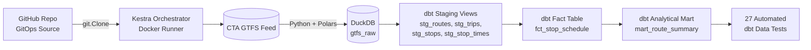
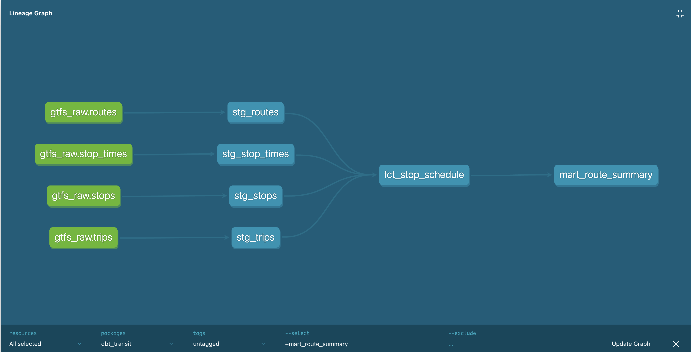
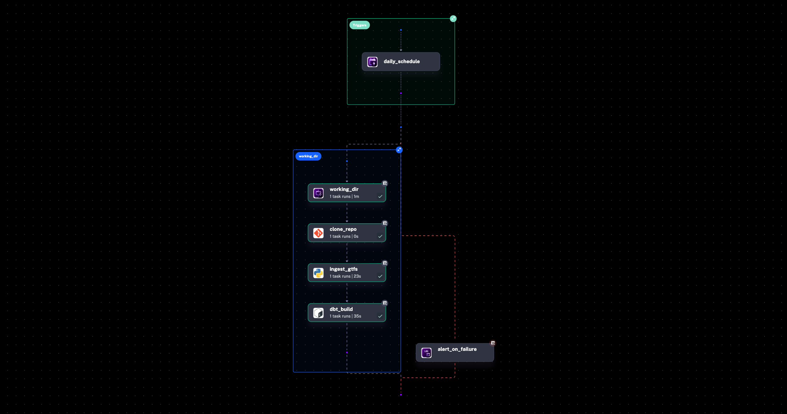

# CTA GTFS Transit Data Engineering Platform

An end-to-end, containerized GitOps ELT data platform that ingests Chicago Transit Authority (CTA) General Transit Feed Specification (GTFS) schedule feeds into an analytical DuckDB warehouse, transforms raw transit feeds into dimensional models with dbt, enforces 27 automated data quality tests, and orchestrates daily scheduled runs via Kestra and Docker.

---

## Architecture Overview



### Tech Stack
- Orchestration & GitOps: Kestra (`WorkingDirectory`, `git.Clone`, exponential retry policies, cron scheduling)
- Compute & Containerization: Docker (`ghcr.io/kestra-io/dbt-duckdb`)
- Ingestion: Python, Polars, Requests
- Data Warehouse: DuckDB (columnar OLAP storage)
- Transformation & Testing: dbt (`dbt-duckdb` 1.12+, 6 models, 27 schema & referential integrity tests)

---

## Data Lineage & Orchestration

### dbt Dimensional Model Lineage
Raw GTFS source tables are standardized through a four-model staging layer, joined into a granular stop-event fact table (`fct_stop_schedule`), and aggregated into route- and direction-level analytical metrics (`mart_route_summary`).



### Kestra GitOps Execution Flow
Every scheduled or manual run dynamically clones the latest `main` branch from GitHub into an isolated Docker working directory, executes Python GTFS ingestion, and runs `dbt build` with exponential backoff retries.



---

## Sample Output: `mart_route_summary`

Top 10 CTA rail route-directions ranked by total scheduled trips:

| Route ID | Route Name | Mode | Direction | Scheduled Trips | Total Stop Events | Avg Duration (min) | Avg Stops / Trip |
| :--- | :--- | :--- | :--- | ---: | ---: | ---: | ---: |
| `P` | Purple Line | Rail | Loop / Express (`0`) | 1,151 | 14,303 | 20.3 | 12.4 |
| `Red` | Red Line | Rail | North | 1,088 | 35,904 | 64.7 | 33.0 |
| `Red` | Red Line | Rail | South | 1,088 | 35,904 | 64.1 | 33.0 |
| `Blue` | Blue Line | Rail | North | 1,003 | 31,545 | 77.9 | 31.5 |
| `Blue` | Blue Line | Rail | South | 1,003 | 31,535 | 77.5 | 31.4 |
| `Y` | Yellow Line | Rail | Skokie Swift (`0`) | 884 | 2,652 | 8.8 | 3.0 |
| `Brn` | Brown Line | Rail | Loop (`0`) | 840 | 37,440 | 80.7 | 44.6 |
| `Org` | Orange Line | Rail | Loop (`0`) | 756 | 17,148 | 57.6 | 22.7 |
| `G` | Green Line | Rail | South | 708 | 19,824 | 62.5 | 28.0 |
| `G` | Green Line | Rail | North | 708 | 19,824 | 57.7 | 28.0 |

---

## Project Structure

```text
transit-data-platform/
├── assets/
│   ├── dbt_lineage.png            # dbt docs end-to-end lineage graph
│   └── kestra_topology.jpeg       # Kestra GitOps workflow topology
├── dbt_transit/
│   ├── models/
│   │   ├── staging/               # Cleaned GTFS views + source definitions
│   │   └── marts/                 # fct_stop_schedule & mart_route_summary
│   ├── dbt_project.yml
│   └── profiles.yml
├── flows/
│   └── gtfs_transit_pipeline.yml  # Kestra GitOps orchestration definition
├── src/
│   └── ingestion/
│       └── fetch_gtfs.py          # GTFS feed downloader & DuckDB loader
└── README.md
```

---

## Quickstart (Local Execution)

1. Clone the repository and set up Python:
   ```bash
   git clone [https://github.com/bleonazemi/transit-data-platform.git](https://github.com/bleonazemi/transit-data-platform.git)
   cd transit-data-platform
   python -m venv .venv && source .venv/bin/activate
   pip install polars requests duckdb dbt-duckdb
   ```

2. Ingest GTFS data and build dbt models:
   ```bash
   mkdir -p data
   python src/ingestion/fetch_gtfs.py
   cd dbt_transit && dbt build --profiles-dir .
   ```

3. Explore dbt documentation & lineage locally:
   ```bash
   dbt docs generate --profiles-dir .
   dbt docs serve --profiles-dir . --port 8090
   ```